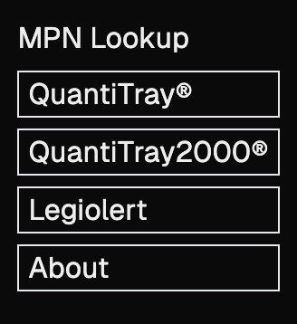
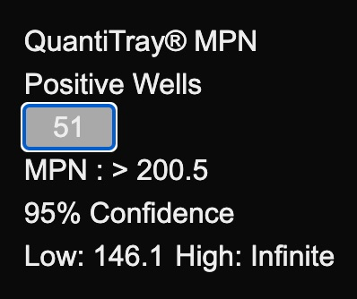

# MPN Lookup

[](https://github.com/jonathan-gartland/mpn-lookup-nextjs/actions/workflows/test.yml)
[](https://github.com/jonathan-gartland/mpn-lookup-nextjs/actions/workflows/playwright.yml)
[](https://github.com/jonathan-gartland/mpn-lookup-nextjs/actions/workflows/deploy.yml)
[](./LICENSE)

A small web app for Most Probable Number (MPN) lookups on IDEXX Quanti-Tray®, Quanti-Tray®/2000
and Legiolert® water tests. Choose a test, enter the positive well counts, and it shows the MPN
with its 95% confidence interval.

**[Live demo →](https://jonathan-gartland.github.io/mpn-lookup-nextjs/)**

<p>
  
  &nbsp;&nbsp;
  200.5, 95% CI 146.1 to infinite" width="240">
</p>

The lookups come from [`mpn-lookup`](https://www.npmjs.com/package/mpn-lookup), my TypeScript
library of the IDEXX MPN tables. The app shows exactly what the library returns.

## Tech

- [Next.js](https://nextjs.org/) 15 (pages router), React 18, TypeScript, Tailwind CSS
- Static export (`output: "export"`) deployed to GitHub Pages under `/mpn-lookup-nextjs`
- Jest and React Testing Library for component tests, Playwright for end-to-end tests

## Testing

I built this app to practice testing a React app at every layer:

| Layer          | Tool                         | What it covers                                                                                      |
| -------------- | ---------------------------- | --------------------------------------------------------------------------------------------------- |
| Component      | Jest + React Testing Library | Home view navigation; `LookupComponent` input and results for each test type                        |
| End-to-end     | Playwright                   | Menu flows, each calculator screen, About, and page metadata (favicon, title, link preview tags)    |
| Data integrity | Jest                         | A checksum over every lookup the app displays, so a dependency update that changes a value fails CI |

The e2e suite runs in Chromium, Firefox and WebKit on pushes and pull requests to `main`.

## Running locally

Requires Node 24 and pnpm.

```bash
git clone https://github.com/jonathan-gartland/mpn-lookup-nextjs.git
cd mpn-lookup-nextjs
pnpm install
pnpm dev                     # http://localhost:3000/mpn-lookup-nextjs
```

```bash
pnpm test                    # Jest unit and component tests
pnpm exec playwright test    # e2e tests (starts the dev server itself)
pnpm check-types && pnpm check-lint && pnpm check-format
pnpm build                   # static export to out/
```

## Reference tables

The MPN values come from the IDEXX reference tables:
[Quanti-Tray (51-well)](https://www.idexx.com/files/51-well-quanti-tray-mpn-table-h-en.pdf),
[Quanti-Tray/2000](https://www.idexx.com/files/qt97mpntable.pdf) and
[Legiolert](https://www.idexx.com/files/quanti-tray-legiolert-mpn-table.pdf).

This project is not affiliated with or endorsed by IDEXX Laboratories. Quanti-Tray and Legiolert
are trademarks of IDEXX Laboratories, Inc. Always confirm reportable results against the official
IDEXX documentation for your test.

## License

[MIT](./LICENSE) © Jonathan Gartland
